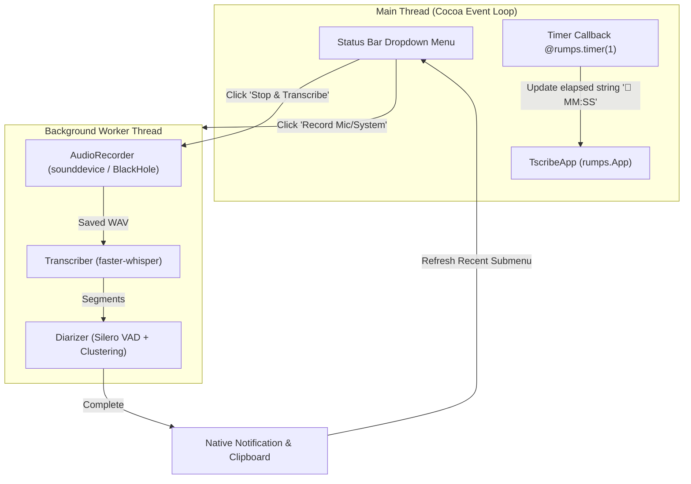

# Design: macOS Menu Bar App (`tscribe app`)

**Status:** Draft / Pending Review  
**Date:** 2026-10-15  
**Target Platform:** macOS (Darwin ARM64/x86_64)  

---

## 1. Executive Summary

This feature adds a native macOS status/menu bar application to `tscribe` (`tscribe app`) using `rumps` (Python Cocoa `NSStatusBar` framework). 

It allows users to control recordings (Microphone or System Audio) directly from their macOS menu bar with live elapsed-time feedback (`🔴 00:15`), toggle speaker diarization, automatically transcribe in the background, receive native macOS completion notifications, and copy or open the resulting transcripts with a single click.

---

## 2. Architecture & Concurrency Model

macOS Cocoa applications require the main thread to run the `NSApplication` event loop. Long-running tasks (audio streaming, faster-whisper transcription, diarization clustering) run on dedicated background threads.



### State Machine:
- **`IDLE`:** Menu icon `🎙️`. Record options enabled; Stop disabled.
- **`RECORDING`:** Menu title `🔴 00:15` (updates every second). Stop enabled; Record options disabled.
- **`TRANSCRIBING`:** Menu title `⏳ Transcribing...`. All capture buttons disabled.
- **`DONE`:** Sends native notification (`rumps.notification`), updates `Recent Recordings` submenu, returns to `IDLE`.

---

## 3. Menu Layout & User Interactions

```text
🎙️  (Menu Bar Icon)
│
├── 🔴 Record Microphone
├── 💻 Record System Audio
├── ⏹️ Stop & Transcribe            (Disabled when idle)
├── ─────────────────────────────
├── ✓ Diarize Speakers              (Toggle checkbox)
├── ─────────────────────────────
├── 📋 Copy Last Transcript         (Copies text directly to macOS clipboard)
├── 📄 Open Last Transcript         (Opens in default editor via tscribe open)
├── 📂 Recent Recordings            (Submenu: last 5 sessions)
│   ├── 2026-10-15 13:53 (25s)
│   ├── 2026-10-15 11:26 (12s)
│   └── ...
├── ─────────────────────────────
└── ❌ Quit tscribe
```

### Clipboard & Notification Integration:
- **Clipboard:** When `Copy Last Transcript` is clicked (or automatically after transcription if configured), text is piped to macOS pasteboard (`pbcopy` / `NSPasteboard`).
- **Notifications:** Uses native `NSUserNotification` through `rumps.notification(title, subtitle, message)`.

---

## 4. CLI Interface & Platform Guard

### CLI Invocation:
```bash
# Launch menu bar app
tscribe app

# Launch with diarization enabled by default
tscribe app --diarize
```

### Platform Compatibility:
If invoked on Linux or Windows:
```text
Error: 'tscribe app' menu bar is only supported on macOS.
```

---

## 5. Dependencies & Desktop Packaging

### Dependencies:
```toml
dependencies = [
    ...,
    "rumps>=0.4.0; sys_platform == 'darwin'",
]
```

### Standalone Desktop `.app` Launcher:
To allow launching from macOS Spotlight (`Cmd + Space`) or Dock without opening a terminal, provide an installer flag:
```bash
tscribe app --install-desktop
```
This writes an AppleScript bundle at `~/Applications/tscribe.app` that executes `tscribe app` in the background.

---

## 6. Testing Strategy

1. **Unit Tests:**
   - App state transitions (`IDLE` $\rightarrow$ `RECORDING` $\rightarrow$ `TRANSCRIBING` $\rightarrow$ `IDLE`).
   - Elapsed time string formatting (`00:00`, `01:23`, `01:05:32`).
   - Platform check raising clear error on non-Darwin platforms.
   - Recent recordings submenu builder with mocked `SessionManager`.
2. **Integration Verification:**
   - Launch app headless/mocked event loop to verify start/stop signals trigger recorder and transcriber correctly.
