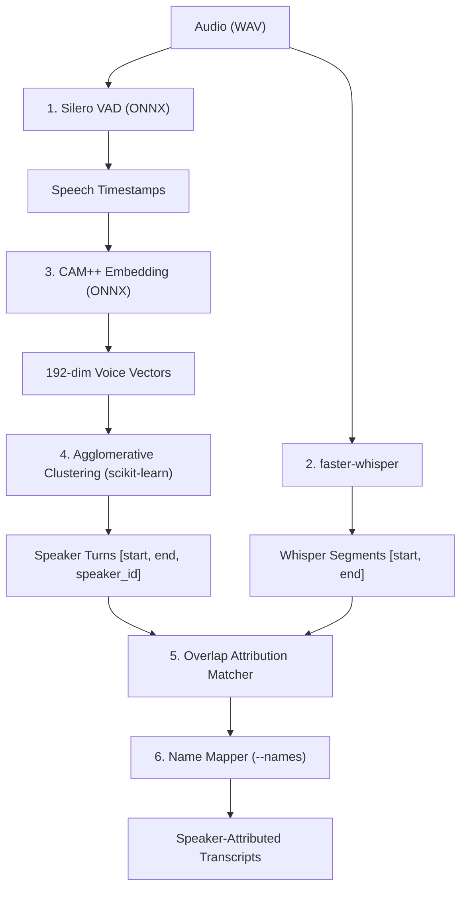

# Design: Offline Speaker Diarization with Custom Speaker Names

**Status:** Draft / Pending Review
**Date:** 2026-10-15
**Target Version:** v1.2

---

## 1. Executive Summary

This feature extends `tscribe` to support offline speaker diarization ("who spoke when") for multi-speaker recordings (3–6+ participants), with optional speaker count hints and custom name mapping (`--names "Alice,Bob"`).

The architecture leverages lightweight ONNX models running on `onnxruntime` (already present in the environment), eliminating heavy PyTorch dependencies and avoiding gated Hugging Face repositories that fail under restrictive corporate proxies (e.g., Zscaler).

---

## 2. Processing Pipeline

The diarization engine acts as an attribution post-pass on the recorded audio and faster-whisper transcription segments.



### Steps:
1. **Voice Activity Detection:** Uses bundled Silero VAD (`faster_whisper/assets/silero_vad_v6.onnx`) to extract speech intervals and silence boundaries.
2. **Feature & Embedding Extraction:** For each speech segment, audio frames are passed into the CAM++ ONNX model (`campplus.onnx`, ~24MB) to produce a 192-dimensional speaker embedding vector.
3. **Clustering:**
   - Computes pairwise cosine distance matrix between segment embeddings.
   - Applies Agglomerative Hierarchical Clustering (`scikit-learn`).
   - If `--speakers N` is provided, clusters into exactly $N$ clusters; otherwise, auto-determines cluster count using a calibrated cosine distance threshold (~0.7).
4. **Attribution Matching:** For each transcribed Whisper segment `[seg_start, seg_end]`, calculates temporal overlap against clustered speech turns and assigns the speaker with the maximum overlap.
5. **Name Mapping:** Translates numeric speaker IDs (`Speaker 1`, `Speaker 2`) to custom names if `--names` is provided.

---

## 3. Custom Speaker Naming (`--names`)

Users can supply human-readable names for speakers either during transcription or post-recording.

### Resolution Rules:
1. **Positional Comma-Separated:**
   `--names "Alice,Bob,Charlie"`
   - `Speaker 1` $\rightarrow$ `Alice`
   - `Speaker 2` $\rightarrow$ `Bob`
   - `Speaker 3` $\rightarrow$ `Charlie`
   - Extra speakers without specified names retain their default label (`Speaker 4`, etc.).
2. **Explicit Key-Value Mapping:**
   `--names "1=Alice,3=Charlie"`
   - `Speaker 1` $\rightarrow$ `Alice`
   - `Speaker 2` $\rightarrow$ `Speaker 2` (unchanged)
   - `Speaker 3` $\rightarrow$ `Charlie`

---

## 4. CLI Interface

### Recording & Transcribing:
```bash
# Record with auto-diarization
tscribe record --diarize

# Record with known speaker count and names
tscribe record --diarize --speakers 2 --names "Alice,Bob"

# Transcribe previous recording with diarization
tscribe transcribe HEAD --diarize --names "Alice,Bob"

# Transcribe external WAV file
tscribe transcribe meeting.wav --diarize --speakers 4
```

### Post-Processing Command (`tscribe label`):
Allows re-labeling an existing transcript without re-running transcription or ML:
```bash
# Relabel last session
tscribe label HEAD --names "Alice,Bob"

# Relabel specific session
tscribe label 2026-10-15-135309 --names "Alice,Bob"
```

### Configuration Defaults:
```bash
tscribe config transcription.diarize true
```

---

## 5. Schema & Output Formats

### Data Schema (`src/tscribe/transcriber.py`)
```python
@dataclass
class TranscriptSegment:
    start: float
    end: float
    text: str
    confidence: float = 0.0
    speaker: str | None = None  # e.g., "Alice" or "Speaker 1"
```

### Output Formats:
- **Plain Text (`.txt`):** Groups consecutive segments by the same speaker:
  ```text
  [Alice]:
  Hello everyone, let's get started.

  [Bob]:
  Thanks Alice. I have the slides ready.
  ```
- **JSON (`.json`):**
  ```json
  {
    "file": "2026-10-15-135309.wav",
    "model": "small",
    "language": "en",
    "segments": [
      {
        "start": 0.0,
        "end": 2.5,
        "speaker": "Alice",
        "text": "Hello everyone, let's get started.",
        "confidence": 0.95
      }
    ]
  }
  ```
- **WebVTT (`.vtt`):** Uses standard `<v Speaker>` tags:
  ```vtt
  00:00:00.000 --> 00:00:02.500
  <v Alice>Hello everyone, let's get started.</v>
  ```
- **SRT (`.srt`):** Prefixes text with speaker label:
  ```srt
  1
  00:00:00,000 --> 00:00:02,500
  [Alice] Hello everyone, let's get started.
  ```

---

## 6. Dependencies & Offline Model Management

### Dependencies:
- `onnxruntime`: Pre-existing dependency in project.
- `scikit-learn`: Required for `AgglomerativeClustering`.

### Model Delivery:
- **Silero VAD:** Bundled inside `faster-whisper` (`faster_whisper/assets/silero_vad_v6.onnx`).
- **CAM++ Model (`campplus.onnx`, ~24MB):**
  - Downloaded to `~/.tscribe/models/campplus.onnx`.
  - Supports offline manual placement when internet/Hugging Face is blocked.

---

## 7. Testing Strategy

1. **Unit Tests:**
   - Speaker name parsing (`"Alice,Bob"` and `"1=Alice,2=Bob"`).
   - Attribution matcher logic with overlapping intervals.
   - Text/JSON/VTT formatters with and without speaker labels.
2. **Integration Tests:**
   - Synthetic 2-speaker audio WAV transcription with `--diarize`.
   - `tscribe label` updating artifacts without altering audio or transcription timestamps.
