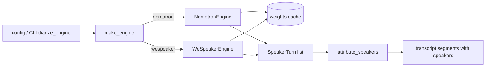

# Architecture & Technical Design

## 1. Overview & Invariants
Extract the diarization engine behind a small protocol, keep today's pipeline as `WeSpeakerEngine`, and add
`NemotronEngine` as the new default (REQ-DIAR-1/2). A factory resolves `diarize_engine` once per run.

Invariants:
- `attribute_speakers` and `SpeakerTurn` are unchanged (REQ-DIAR-2).
- Audio never leaves the machine; only weights are downloaded (REQ-DIAR-3/7).
- No silent engine fallback; unavailable runtime/weights raise (REQ-DIAR-5).
- The Nemotron runtime is imported lazily, only by `NemotronEngine` (NFR-DIAR-1).

Unverified (model card unreadable): Nemotron runtime/API, speaker cap, weight size, licence. Items marked
**TBD-model** below MUST be confirmed before tasks are executed.

## 2. Domain Models, State & Interface Contracts
```python
class DiarizationEngine(Protocol):
    def diarize(self, audio_path: Path | str, num_speakers: int | None = None) -> list[SpeakerTurn]: ...

def make_engine(name: str, models_dir: Path | None = None) -> DiarizationEngine
# name in {"nemotron", "wespeaker"}; otherwise ValueError listing valid names (REQ-DIAR-1)
```
- `Diarizer` (current class) becomes `WeSpeakerEngine`; `Diarizer` remains as an alias so existing callers/tests keep working.
- `NemotronEngine.max_speakers: int` (**TBD-model**); `diarize` raises `ValueError` naming the cap when
  `num_speakers` exceeds it (REQ-DIAR-6).
- Config: `TranscriptionConfig.diarize_engine: str = "nemotron"`; CLI `--diarize-engine [nemotron|wespeaker]`
  on `record`, `transcribe`, and `app`; config key `diarize_engine` in `config.example.toml`.
- Errors: `EngineUnavailableError(RuntimeError)` for missing runtime/weights, with the component and fix in the message.

No persistent state beyond the cached weights directory `get_data_dir()/models/diarization/<engine>/`.

## 3. Architecture Diagram & Data Flow

`Transcriber.transcribe(..., diarize=True)` calls `make_engine(cfg.diarize_engine).diarize(...)` instead of `Diarizer()`.

## 4. Boundary Rules & Budgets
- **Pure Core vs. I/O Shell**: pure core = `SpeakerTurn`, `attribute_speakers`, engine-name validation, speaker-cap check,
  turn post-processing. I/O shell = weight download (existing truststore + temp-file atomic move, reused by both engines),
  audio decoding, model inference, lazy runtime import.
- **Concurrency, Latency & Resource Budgets**: diarization stays synchronous per file, as today. Weights download once
  (REQ-DIAR-3), atomically via temp dir so no partial file remains. NFR-DIAR-1: WeSpeaker path never imports the Nemotron
  runtime. NFR-DIAR-2: record packaged-app size with and without the runtime; no numeric budget until measured.
- **Packaging (REQ-DIAR-4)**: add the Nemotron runtime to the Python deps used by the app build (`Makefile` app target /
  `pyproject.toml`). **TBD-model**: dependency set and whether it supports Apple Silicon (MPS/CPU) in a self-contained bundle.
  Weights are not bundled.
- **Migration**: default flips to Nemotron; users keep old output with `diarize_engine = "wespeaker"`.

## 5. Testing Strategy
1. **BDD Scenarios**: one per spec scenario: default engine, wespeaker selected, invalid value, first-run download,
   download failure leaves no partial file, missing runtime error, speaker cap, offline with cached weights,
   WeSpeaker path does not import the Nemotron runtime, packaged-app smoke run on a sample file.
2. **Unit Tests (>= 95% coverage)**: `make_engine` dispatch/validation, cap check, error messages, config/CLI parsing,
   shared download helper; the Nemotron model call is faked behind the protocol, so tests need no real weights.
   Existing `test_diarizer_engine.py` / attribution tests must pass unchanged via the `Diarizer` alias.
3. **Mutation Testing (100% kill)**: `make_engine`, cap check, and config validation (the pure core). The repo already
   has a `mutants/` setup to reuse.

## Review Gate
- [ ] **Gate 3 Approval**: Architecture & design reviewed and approved by human before task breakdown.
