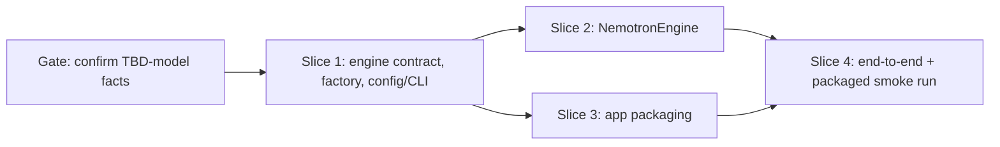

# Tasks

## 1. Dependency DAG

Slice 0 is a prerequisite check, not code: confirm Nemotron runtime, speaker cap, licence, weight size and Apple Silicon
support from the model card (design TBD-model items).

## 2. Streams & Worktrees
Streams are created only after the Slice 1 contract is committed.

| Stream | Worktree Path | Branch | Prerequisite |
| :--- | :--- | :--- | :--- |
| main | `.` | `feat/nemotron-diarization-engine` | none |
| nemotron | `.worktrees/diar-nemotron` | `feat/diar-nemotron` | Slice 1 committed |
| packaging | `.worktrees/diar-packaging` | `feat/diar-packaging` | Slice 1 committed, Slice 0 done |

## 3. Slice 0: Confirm model facts

- [ ] 3.1 Record runtime/API, max speakers, licence, weight size, Apple Silicon support in `design.md` (verify: TBD-model markers replaced with facts, or a No-Go noted)

## 4. Slice 1: Engine contract, factory, config/CLI (REQ-DIAR-1, REQ-DIAR-2, REQ-DIAR-5, NFR-DIAR-1)

- [ ] 4.1 BDD scenarios: default engine, wespeaker selected, invalid value, WeSpeaker path never imports the Nemotron runtime (verify: `.feature` committed)
- [ ] 4.2 Gate 5.1 human sign-off on BDD scenarios
- [ ] 4.3 Red unit tests for `make_engine`, config `diarize_engine`, CLI `--diarize-engine` on `record`/`transcribe`/`app` (verify: fail for the expected reason; append `Evidence:`)
- [ ] 4.4 Green: `DiarizationEngine` protocol, `make_engine`, `WeSpeakerEngine` with `Diarizer` alias, `EngineUnavailableError`, `Transcriber` uses the factory; default `nemotron` (verify: `make test` passes incl. existing diarizer/attribution tests; append `Evidence:`)
- [ ] 4.5 Coverage >= 95% and mutation 100% kill on factory and config validation (verify: reports; append `Evidence:`)

## 5. Slice 2: NemotronEngine (REQ-DIAR-3, REQ-DIAR-5, REQ-DIAR-6, REQ-DIAR-7)

- [ ] 5.1 BDD scenarios: first-run download, download failure leaves no partial file, missing runtime error, speaker cap, offline with cached weights (verify: `.feature` committed)
- [ ] 5.2 Gate 5.2 human sign-off on BDD scenarios
- [ ] 5.3 Red unit tests with the model call faked (verify: fail for the expected reason; append `Evidence:`)
- [ ] 5.4 Green: shared weight-download helper, lazy runtime import, cap check, `diarize()` returning `SpeakerTurn`s (verify: suite passes; append `Evidence:`)
- [ ] 5.5 Coverage >= 95% and mutation 100% kill on the cap check and helper logic (verify: reports; append `Evidence:`)

## 6. Slice 3: App packaging (REQ-DIAR-4, NFR-DIAR-2)

- [ ] 6.1 BDD scenario: packaged app runs Nemotron on a sample recording without a separately installed runtime (verify: `.feature` committed)
- [ ] 6.2 Gate 5.3 human sign-off on BDD scenario
- [ ] 6.3 Add the runtime to the app build deps (`pyproject.toml`, `Makefile` app target) (verify: `make app` succeeds; append `Evidence:`)
- [ ] 6.4 Measure and record app size with and without the runtime (verify: numbers recorded in `design.md`; append `Evidence:`)

## 7. Slice 4: End to end

- [ ] 7.1 Packaged-app smoke run with the default engine and with `wespeaker` on a sample file (verify: speaker turns produced; append `Evidence:`)
- [ ] 7.2 Update README, `config.example.toml`, `docs/macos-app.md` for `diarize_engine` and the new default (verify: docs mention default, first-use download, and the wespeaker opt-out)

## 8. Integration & Rebase Plan
- [ ] 8.1 Merge nemotron and packaging streams, rebase on `master`, re-run `make check`, then `openspec archive`

## Review Gate
- [ ] **Gate 4 Approval**: Tasks breakdown approved by human before writing test code.
