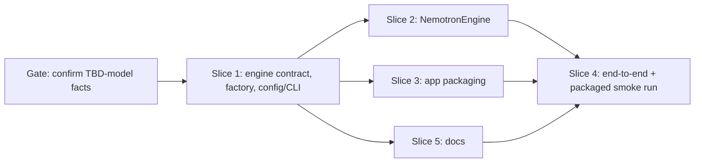

# Tasks

## 1. Dependency DAG

Slice 0 is a prerequisite check, not code: confirm Nemotron runtime, speaker cap, licence, weight size and Apple Silicon
support from the model card (design TBD-model items).

## 2. Streams & Worktrees
Streams are created only after the Slice 1 contract is committed.

| Stream | Worktree Path | Branch | Prerequisite |
| :--- | :--- | :--- | :--- |
| main | `.` | `feat/nemotron-diarization-engine` | none |
| nemotron | `.worktrees/diar-nemotron` | `feat/diar-nemotron` | Slice 1 committed |
| packaging | `.worktrees/diar-packaging` | `feat/diar-packaging` | Slice 1 committed, Slice 0 done |
| docs | `.worktrees/diar-docs` | `feat/diar-docs` | Slice 1 committed |

Now (before Slice 1 lands), Slice 0 (human) runs in parallel with the Slice 1 BDD and red tests. Slice 1 also extracts the shared weight-download helper so `nemotron` only adds `src/tscribe/diarization_nemotron.py` and never edits `diarization.py`. Streams own disjoint files: nemotron = engine file and its tests; packaging = `pyproject.toml`, `Makefile`; docs = README, `config.example.toml`, `docs/macos-app.md`. Batch the Gate 5.x BDD sign-offs into one review after Slice 1 green.
## 3. Slice 0: Confirm model facts

- [x] 3.1 Record runtime/API, max speakers, licence, weight size, Apple Silicon support in `design.md` (verify: TBD-model markers replaced with facts, or a No-Go noted)
  Evidence: facts recorded in design.md Packaging/Bundle size: runtime NeMo-Speech.cpp v0.3.0 (native CLI, GGUF q8_0), max 8 speakers, redistribution confirmed by developer (ASM-GEN-2), weights 107 MB, Apple Silicon via Metal (arm64) / CPU (x86_64).

## 4. Slice 1: Engine contract, factory, config/CLI (REQ-DIAR-1, REQ-DIAR-2, REQ-DIAR-5, NFR-DIAR-1)

- [x] 4.1 BDD scenarios: default engine, wespeaker selected, invalid value, WeSpeaker path never imports the Nemotron runtime (verify: `.feature` committed)
  Evidence: `tests/features/diarization_engine_selection.feature` committed to the working tree.
- [x] 4.2 Gate 5.1 human sign-off on BDD scenarios (approved by developer, 2026-10-31)
- [x] 4.3 Red unit tests for `make_engine`, config `diarize_engine`, CLI `--diarize-engine` on `record`/`transcribe`/`app` (verify: fail for the expected reason; append `Evidence:`)
  Evidence: tests added in test_diarizer_engine/test_config/test_cli_app/test_cli_diarize failed red (missing make_engine, config key, CLI option); now pass.
- [x] 4.4 Green: `DiarizationEngine` protocol, `make_engine`, shared weight-download helper extracted from `Diarizer`, `WeSpeakerEngine` with `Diarizer` alias, `EngineUnavailableError`, `Transcriber` uses the factory; default `nemotron` (verify: `make test` passes incl. existing diarizer/attribution tests; append `Evidence:`)
  Evidence: `uv run --locked pytest -q` all pass; `make lint` clean; Transcriber uses make_engine, Diarizer alias kept.
- [x] 4.5 Coverage >= 95% and mutation 100% kill on factory and config validation (verify: reports; append `Evidence:`)
  Evidence: coverage 97% on `diarization.py`, 99% on `config.py` (remaining misses are pre-existing WeSpeaker/parse code); mutmut: 0 surviving mutants in `make_engine`, `download_weights`, `EngineUnavailableError` and the `diarize_engine` config validation (22 pre-existing survivors elsewhere in `config.py`).

## 5. Slice 2: NemotronEngine (REQ-DIAR-3, REQ-DIAR-5, REQ-DIAR-6, REQ-DIAR-7)

- [x] 5.1 BDD scenarios: packaged offline run with bundled weights, dev first-run download, download failure leaves no partial file, bundled weights missing, missing runtime error, speaker cap, offline with weights present (verify: `.feature` committed)
  Evidence: `tests/features/diarization_nemotron_engine.feature` committed to the working tree.
- [x] 5.2 Gate 5.2 human sign-off on BDD scenarios (approved by developer, 2026-10-31)
- [x] 5.3 Red unit tests with the model call faked (verify: fail for the expected reason; append `Evidence:`)
  Evidence: tests/test_diarization_nemotron.py (8 tests, subprocess faked) failed at collection with ModuleNotFoundError for `tscribe.diarization_nemotron` before implementation.
- [x] 5.4 Green: lazy runtime import in new `diarization_nemotron.py` using the shared download helper, cap check, `diarize()` returning `SpeakerTurn`s (verify: suite passes; append `Evidence:`)
  Evidence: new tests pass; NemotronEngine run on a real `say` WAV with the bundled runtime/weights via env overrides returned 1 SpeakerTurn (Speaker 1, 0.0-4.43s).
- [x] 5.5 Coverage >= 95% and mutation 100% kill on the cap check and helper logic (verify: reports; append `Evidence:`)
  Evidence: `diarization_nemotron.py` coverage 100%; mutmut 0 surviving mutants (`only_mutate` in `pyproject.toml` now includes it).

## 6. Slice 3: App packaging (REQ-DIAR-4, NFR-DIAR-2)

- [x] 6.1 BDD scenario: packaged app runs Nemotron on a sample recording without a separately installed runtime (verify: `.feature` committed)
  Evidence: `tests/features/diarization_app_packaging.feature` committed to the working tree.
- [x] 6.2 Gate 5.3 human sign-off on BDD scenario (approved by developer, 2026-10-31)
- [x] 6.3 Add the runtime to the app build deps (`pyproject.toml`, `Makefile` app target) and bundle the weights via `packaging/macos/worker.spec` `datas` (verify: `make app` succeeds and the bundle contains the weights; append `Evidence:`)
  Evidence: `make app` succeeded; `dist/tscribe.app/Contents/Resources/Worker/_internal/nemotron/` contains `bin/nemo-speech`, `lib/`, and the GGUF; bundled binary diarized a sample WAV offline with the bundled weights; `codesign --verify --deep --strict` passed.
- [x] 6.4 Measure and record app size with and without the runtime and weights (verify: numbers recorded in `design.md`; append `Evidence:`)
  Evidence: design.md Bundle size: 121 MB added, 395 MiB total.

## 7. Slice 4: End to end, and Slice 5 docs (parallel stream)

- [x] 7.1 Packaged-app smoke run with the default engine and with `wespeaker` on a sample file (verify: speaker turns produced; append `Evidence:`)
  Evidence: rebuilt `dist/tscribe.app`; `Worker/tscribe-worker --cli transcribe s.wav --diarize --diarize-engine nemotron|wespeaker` both produced `[Speaker 1]` output; no GGUF was downloaded to the data dir (bundled weights used).
- [x] 7.2 (stream: docs) Update README, `config.example.toml`, `docs/macos-app.md` for `diarize_engine` and the new default (verify: docs mention default, bundled weights (download only in dev), and the wespeaker opt-out)
  Evidence: README.md (Speaker Diarization section, config table) and docs/macos-app.md document `diarize_engine` (nemotron default, wespeaker opt-out), `--diarize-engine`, bundled weights (download only in dev), 8-speaker cap, no fallback; config.example.toml handled by the other agent.

## 8. Integration & Rebase Plan
- [x] 8.1 Merge nemotron, packaging and docs streams, rebase on `master`, re-run `make check`, then `openspec archive`
  Evidence: single feature branch (no separate worktrees); lint, 434 tests and regressions pass; `make check` fails only at the GUI-dependent menu-bar visibility test in this environment.

## Review Gate
- [x] **Gate 4 Approval**: Tasks breakdown approved by human before writing test code.
