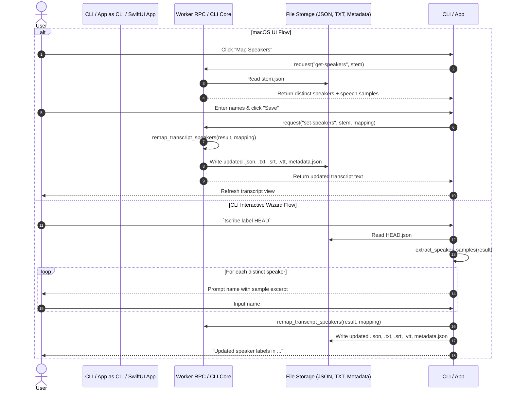

# Architecture & Technical Design

## 1. Overview & Invariants

This design introduces interactive speaker re-labeling in both the CLI and the macOS SwiftUI menu bar app. It anchors all remapping to an immutable `raw_speaker` attribute on each segment.

### Invariants
1. **Raw Cluster Immutability**: `raw_speaker` is assigned when diarization runs and is never overwritten by subsequent renamings. If an older transcript JSON without `raw_speaker` is encountered, `raw_speaker` defaults to the existing `speaker` string.
2. **Deterministic & Idempotent Remapping**: All speaker remapping applies against `raw_speaker` (`mapped_speaker = speaker_map.get(raw_speaker, raw_speaker)`). Re-running mapping with new names or resetting to default is completely lossless.
3. **Multi-Format Atomic Synchronization**: When speaker labels are updated, the transcript JSON, all existing formatted outputs (`.txt`, `.srt`, `.vtt`), and `metadata.json` (`speaker_map`) are updated together.

## 2. Domain Models, State & Interface Contracts

### 2.1 Domain Model Updates (`tscribe.transcriber`)
```python
@dataclass
class TranscriptSegment:
    start: float
    end: float
    text: str
    confidence: float = 0.0
    speaker: Optional[str] = None
    raw_speaker: Optional[str] = None

    def to_dict(self) -> dict:
        d = {
            "start": self.start,
            "end": self.end,
            "text": self.text,
            "confidence": self.confidence,
            "speaker": self.speaker,
        }
        if self.raw_speaker is not None:
            d["raw_speaker"] = self.raw_speaker
        return d
```

When constructing segments from JSON dictionaries:
`raw_speaker = d.get("raw_speaker") or d.get("speaker")`

### 2.2 Pure Core Functions (`tscribe.diarization`)
```python
def extract_speaker_samples(result: TranscriptResult) -> list[dict[str, Any]]:
    """Extract distinct speakers, their raw_speaker, current speaker, and first speech excerpt."""

def remap_transcript_speakers(
    result: TranscriptResult,
    speaker_map: dict[str, str],
) -> TranscriptResult:
    """Return a new TranscriptResult with speaker fields updated from raw_speaker."""
```

### 2.3 Worker RPC Commands (`tscribe.worker`)
- `get-speakers`:
  - Request: `{"command": "get-speakers", "stem": "<stem>"}`
  - Response:
    ```json
    {
      "speakers": [
        {
          "raw_speaker": "Speaker 1",
          "speaker": "Alice",
          "start": 1.25,
          "sample_text": "Good morning everyone..."
        }
      ]
    }
    ```
- `set-speakers`:
  - Request: `{"command": "set-speakers", "stem": "<stem>", "mapping": {"Speaker 1": "Alice"}}`
  - Action: Updates JSON, TXT, SRT, VTT, records `speaker_map` in `metadata.json`.
  - Response: `{"status": "ok", "message": "Updated speaker labels", "text": "<new_txt>"}`

### 2.4 macOS Desktop App (`macos/Sources/TscribeMac`)
- **Data Model**: `SpeakerEntry(id: String, rawSpeaker: String, name: String, sample: String)`
- **AppModel**:
  - `func loadSpeakers(for stem: String) async -> [SpeakerEntry]`
  - `func updateSpeakers(for stem: String, mapping: [String: String]) async throws`
- **UI Components**:
  - `SpeakerMappingSheet`: Modal sheet presenting speaker rows with text previews, editable `TextField`, "Cancel", "Reset to Default", and "Save" buttons.
  - Triggered by "Map Speakers" button in `TscribeApp.swift` transcript toolbar.

### 2.5 CLI Wizard (`tscribe.cli`)
- `tscribe label <ref>`:
  - If `--names` provided: parse positional/explicit and apply non-interactively.
  - If `--names` omitted: query distinct speakers, display first sample quote, prompt user via `click.prompt` for each name (defaulting to current name).
- Post-transcription gate:
  - Checked against `config.transcription.prompt_speaker_labels` (default: `False`).

## 3. Architecture Diagram & Data Flow



## 4. Boundary Rules & Budgets

- **Pure Core vs. I/O Shell**:
  - `remap_transcript_speakers` and `extract_speaker_samples` are pure functions in `tscribe.diarization` without I/O or framework dependencies.
  - All file mutation is encapsulated in `tscribe.session` and `tscribe.worker`.
  - CLI interactivity is strictly isolated inside `tscribe.cli`.
  - Swift UI is strictly isolated in macOS target.
- **Latency Budget (NFR-SPK-1)**:
  - In-memory remapping + 4 file writes (JSON, TXT, SRT, VTT) must execute in < 100ms for 5,000 segments.

## 5. Testing Strategy

1. **Unit Tests (`tests/test_speaker_mapping.py`)**:
   - `test_remap_speakers_preserves_raw_speaker`: verifies raw speaker is preserved and current speaker updated.
   - `test_remap_speakers_idempotence`: verifies successive remaps calculate off raw speaker.
   - `test_remap_speakers_legacy_fallback`: verifies transcripts missing `raw_speaker` fall back to `speaker`.
   - `test_extract_speaker_samples`: verifies first spoken snippet is extracted accurately.
2. **Worker RPC Tests (`tests/test_worker_speaker_rpc.py`)**:
   - Tests `get-speakers` and `set-speakers` end-to-end against sample session files.
3. **CLI Tests (`tests/test_cli_label.py`)**:
   - Tests interactive prompt with `CliRunner.invoke(input=...)`.
   - Tests non-interactive `--names` argument path.

## Review Gate
- [x] **Gate 3 Approval**: Architecture & design reviewed and approved by human before task breakdown.
