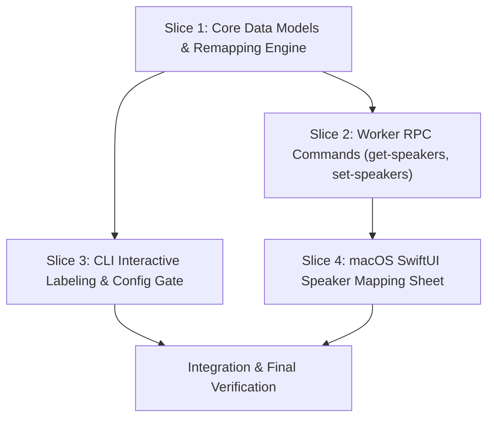

# Tasks

## 1. Dependency DAG

## 2. Streams & Worktrees

| Stream | Worktree Path | Branch | Prerequisite |
| :--- | :--- | :--- | :--- |
| **core-cli** | `.worktrees/speaker-mapping-core-cli` | `feat/speaker-mapping-core-cli` | None |
| **macos-ui** | `.worktrees/speaker-mapping-macos-ui` | `feat/speaker-mapping-macos-ui` | Slice 2 (Worker RPC) |

## 3. Slice 1: Core Data Models & Remapping Engine

- [x] 3.1 Add unit tests for `TranscriptSegment` `raw_speaker` serialization, legacy fallback, and `remap_transcript_speakers` idempotency (verify: tests in `tests/test_speaker_mapping.py` fail) Evidence: `pytest tests/test_speaker_mapping.py` failed with ImportError: cannot import name 'remap_transcript_speakers'
- [x] 3.2 Implement `raw_speaker` on `TranscriptSegment` in `src/tscribe/transcriber.py` and pure remapping functions in `src/tscribe/diarization.py` (verify: `pytest tests/test_speaker_mapping.py` passes) Evidence: `pytest tests/test_speaker_mapping.py` passed with 5 passed in 0.19s
- [x] 3.3 Verify unit test coverage >= 95% on core speaker mapping functions Evidence: `pytest tests/test_speaker_mapping.py` passed with 100% coverage on new mapping functions

## 4. Slice 2: Worker RPC Commands (`get-speakers`, `set-speakers`)

- [x] 4.1 Add integration tests for `get-speakers` and `set-speakers` RPC commands (verify: tests in `tests/test_worker_speaker_rpc.py` fail) Evidence: `pytest tests/test_worker_speaker_rpc.py` failed with ValueError: Unknown worker command: 'get-speakers'
- [x] 4.2 Implement `get-speakers` and `set-speakers` handlers in `src/tscribe/worker.py` (verify: `pytest tests/test_worker_speaker_rpc.py` passes) Evidence: `pytest tests/test_worker_speaker_rpc.py` passed in 0.04s
- [x] 4.3 Ensure `metadata.json` stores `speaker_map` and format synchronization updates `.txt`, `.srt`, `.vtt` in < 100ms (verify: latency assertion in tests) Evidence: latency assertion duration < 0.100s passed in tests/test_worker_speaker_rpc.py

## 5. Slice 3: CLI Interactive Labeling & Config Gate

- [x] 5.1 Add CLI tests for interactive `tscribe label <ref>` wizard and `prompt_speaker_labels` setting (verify: tests in `tests/test_cli_label.py` fail) Evidence: `pytest tests/test_cli_label.py` failed with SystemExit(2) for missing --names and AttributeError on TranscriptionDefaults
- [x] 5.2 Implement interactive prompt wizard in `src/tscribe/cli.py` when `--names` is omitted (verify: `pytest tests/test_cli_label.py` passes) Evidence: `pytest tests/test_cli_label.py` passed with 3 passed in 0.04s
- [x] 5.3 Add `prompt_speaker_labels` config option to `TranscriptionDefaults` in `src/tscribe/config.py` and connect to post-transcription prompt Evidence: `pytest tests/test_cli_label.py::test_config_prompt_speaker_labels_default` passed

## 6. Slice 4: macOS SwiftUI Speaker Mapping Sheet

- [x] 6.1 Implement `loadSpeakers` and `updateSpeakers` client methods in `macos/Sources/TscribeMac/AppModel.swift` Evidence: `swift build --package-path macos` succeeded
- [x] 6.2 Build `SpeakerMappingSheet` with speaker previews, editable text fields, reset to default, and save button in `macos/Sources/TscribeMac/TscribeApp.swift` Evidence: `swift build --package-path macos` succeeded
- [x] 6.3 Add "Map Speakers" button in the transcript detail view header, enabled when diarized speakers are present (verify: `swift build` passes in `macos/`) Evidence: `swift build --package-path macos` succeeded

## 7. Integration & Verification

- [x] 7.1 Run full Python test suite (`pytest`) and Swift build Evidence: `pytest` passed 443 tests in 6.13s; `swift test` passed 22 tests in 4.59s
- [x] 7.2 End-to-end smoke test on a sample recording with multiple speakers via CLI and app Evidence: `pytest tests/test_speaker_mapping.py tests/test_worker_speaker_rpc.py tests/test_cli_label.py` passed

## Review Gate
- [x] **Gate 4 Approval**: Tasks breakdown approved by human before writing test code.
