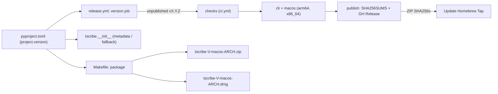

# Architecture & Technical Design

## 1. Overview & Invariants
- **Single-Source Versioning Invariant:** `pyproject.toml` (`[project].version`) is the sole authored version string. `tscribe.__version__` resolves dynamically at import time without hardcoded literals.
- **Frozen Worker Invariant:** `packaging/macos/worker.spec` includes `copy_metadata('tscribe')` so the PyInstaller-bundled `tscribe-worker` resolves `importlib.metadata.version("tscribe")` without needing `pyproject.toml` inside the `.app` bundle.
- **Dual macOS Packaging Invariant:** `make package` produces and verifies both `.zip` (for Homebrew cask) and `.dmg` (for direct macOS installation) in a single atomic staging flow.

## 2. Domain Models, State & Interface Contracts

### `src/tscribe/__init__.py`
```python
def _resolve_version() -> str:
    try:
        return version("tscribe")
    except PackageNotFoundError:
        pyproject = Path(__file__).resolve().parents[2] / "pyproject.toml"
        return tomllib.loads(pyproject.read_text(encoding="utf-8"))["project"]["version"]

__version__: str = _resolve_version()
```
- Uses stdlib `importlib.metadata.version`, `importlib.metadata.PackageNotFoundError`, `pathlib.Path`, and `tomllib` (Python >= 3.11).

### `packaging/macos/worker.spec`
- Add `'tscribe'` to the `copy_metadata` package list so `dist/tscribe.app/Contents/Resources/Worker/tscribe-worker --cli --version` resolves `importlib.metadata.version("tscribe")`.

### `Makefile`
- Define `DMG := dist/tscribe-$(VERSION)-macos-$(ARCH).dmg`.
- In `package: app`:
  1. Build and verify `.zip` via `ditto -c -k` and `unzip -tq` (existing).
  2. Prepare DMG staging dir (`$$archive_stage/dmg`), copy `$(APP)` via `ditto`, create `ln -s /Applications "$$archive_stage/dmg/Applications"`.
  3. Create `$$archive_stage/release.dmg` via `hdiutil create -volname "tscribe" -srcfolder "$$archive_stage/dmg" -ov -format UDZO "$$archive_stage/release.dmg"`.
  4. Verify via `hdiutil verify "$$archive_stage/release.dmg"`.
  5. Move to `$(DMG)` and copy to `dist/tscribe-macos-$(ARCH).dmg`.
- In `checksums`: hash `./*.whl ./*.tar.gz ./*.zip ./*.dmg > SHA256SUMS`.

### `.github/workflows/release.yml`
- `version` job: remove `runpy.run_path('src/tscribe/__init__.py')['__version__']` check; validate `pyproject.toml` `project.version` matches `^\d+\.\d+\.\d+$` and check `gh release view v<version>`.
- `macos` job:
  - Verify `hdiutil verify "dist/tscribe-$VERSION-macos-$ARCH.dmg"`.
  - Upload both `dist/*-macos-${{ matrix.arch }}.zip` and `dist/*-macos-${{ matrix.arch }}.dmg` in `actions/upload-artifact`.
- `publish` job:
  - `sha256sum ./*.whl ./*.tar.gz ./*.zip ./*.dmg > SHA256SUMS` (keep `arm64_sha256` / `x86_64_sha256` outputs pointing to `.zip` for `homebrew-tap`).
  - `gh release upload "$RELEASE_TAG" dist/*.whl dist/*.tar.gz dist/*.zip dist/*.dmg dist/SHA256SUMS --clobber`.

## 3. Architecture Diagram & Data Flow



## 4. Boundary Rules & Budgets
- **Pure Core vs. I/O Shell**: Version resolution in `src/tscribe/__init__.py` is a small module-level helper (`_resolve_version`); `Makefile` and `release.yml` handle all filesystem and `hdiutil` I/O.
- **Concurrency, Latency & Resource Budgets**:
  - `NFR-VER-1`: `_resolve_version()` executes in-process with zero subprocesses or network calls.
  - `NFR-DMG-1`: `hdiutil create` + `hdiutil verify` uses stock macOS binaries with no external package installs.

## 5. Testing Strategy
1. **BDD Scenarios**: Verify all scenarios in `specs/macos-dmg-packaging/spec.md` and `specs/single-source-versioning/spec.md`.
2. **Unit Tests (>= 95% coverage)**:
   - Test `_resolve_version()` when `importlib.metadata.version` succeeds.
   - Test `_resolve_version()` fallback to `pyproject.toml` when `PackageNotFoundError` is raised.
   - Keep `tests/test_desktop.py::test_project_and_cli_versions_match` and `tests/test_cli.py` version assertions passing.
3. **Mutation Testing (100% kill)**: Run `mutmut` / unit verification on `_resolve_version()` if configured, and validate `make package` + `hdiutil verify` on macOS.

## Review Gate
- [ ] **Gate 3 Approval**: Architecture & design reviewed and approved by human before task breakdown.
