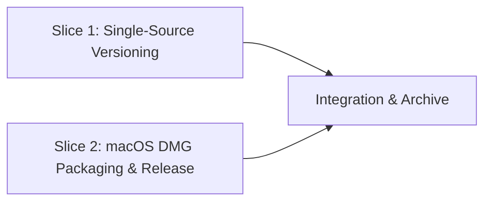

# Tasks

## 1. Dependency DAG

## 2. Streams & Worktrees

| Stream | Worktree Path | Branch | Prerequisite |
| :--- | :--- | :--- | :--- |
| `versioning` | `.worktrees/dmg-release-versioning` | `feat/dmg-release-versioning` | Gate 4 approval |
| `dmg-packaging` | `.worktrees/dmg-release-dmg-packaging` | `feat/dmg-release-dmg-packaging` | Gate 4 approval |

## 3. Slice 1: Single-Source Versioning

- [x] 3.1 Red unit tests for `_resolve_version()` in `tests/test_desktop.py` covering `importlib.metadata.version` and `PackageNotFoundError` fallback to `pyproject.toml` (verify: `uv run --locked --group dev pytest tests/test_desktop.py` fails before implementation) — Evidence: `uv run --locked --group dev pytest tests/test_desktop.py` -> 2 failed, 6 passed (AttributeError: no attribute 'version')
- [x] 3.2 Update `src/tscribe/__init__.py` to resolve `__version__` via `importlib.metadata.version("tscribe")` with `pyproject.toml` fallback, add `'tscribe'` to `copy_metadata` in `packaging/macos/worker.spec`, and remove the `__init__.py` comparison from `.github/workflows/release.yml` `version` job (verify: `uv run --locked --group dev pytest tests/test_desktop.py tests/test_cli.py` passes) — Evidence: `uv run --locked --group dev pytest tests/test_desktop.py tests/test_cli.py` -> 77 passed in 2.27s
- [x] 3.3 Verify lint and full Python test suite pass (verify: `make lint && make test`) — Evidence: `make lint` -> All checks passed!; `make test` -> 445 passed, 4 deselected in 7.54s

## 4. Slice 2: macOS DMG Packaging & Release

- [x] 4.1 Update `Makefile` (`DMG` variable, `package` target with `hdiutil create` + `hdiutil verify`, and `checksums` target with `./*.dmg`) (verify: `make package` on macOS produces verified `dist/tscribe-$(VERSION)-macos-$(ARCH).dmg` and `.zip`, and `make checksums` includes `.dmg` in `dist/SHA256SUMS`) — Evidence: `make package` (`hdiutil: verify: checksum ... is VALID`, `tscribe-2.4.1-macos-arm64.dmg` 226.7M) & `make cli && make checksums` (`dist/SHA256SUMS` includes `.whl`, `.tar.gz`, `.zip`, `.dmg`) & `tscribe-worker --cli --version` -> `tscribe, version 2.4.1`
- [x] 4.2 Update `.github/workflows/release.yml` (`macos` job verifies `.dmg` with `hdiutil verify` and uploads `.dmg` alongside `.zip`; `publish` job includes `./*.dmg` in `SHA256SUMS` and `gh release upload` while keeping `homebrew-tap` on `.zip`) (verify: YAML syntax and workflow diff review) — Evidence: `yaml.safe_load` -> `YAML OK`

## 5. Integration & Rebase Plan

- [ ] 5.1 Human Comprehension Verification: reviewer can explain all generated logic line-by-line
- [ ] 5.2 Merge streams, rebase on `main`, run `make check`, `openspec validate "dmg-release-and-single-version" --strict`, and `openspec archive "dmg-release-and-single-version"`

## Review Gate
- [ ] **Gate 4 Approval**: Tasks breakdown approved by human before writing test code.
